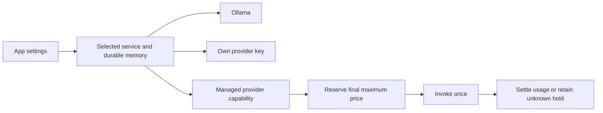
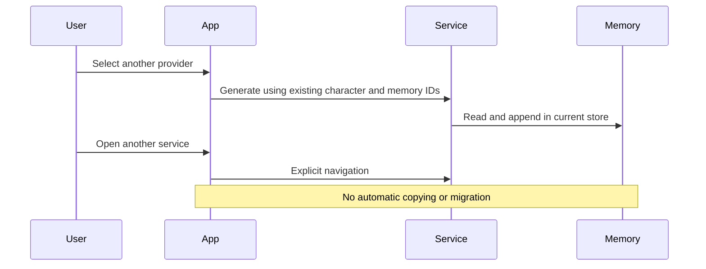

# Memory location, providers and spending

Settings separates the service that stores memory from the provider that generates responses. This computer stores memory in the local service's configured data directory. A self-hosted service stores it on that server. A managed service stores it in the authenticated user's isolated service storage. The browser displays the current service origin.

Changing the model or provider keeps the same memory IDs and stored records. Opening another service is an explicit navigation to a separate store; it does not copy or synchronize memory. Export/import remains a filtered new-identity fork, not a same-identity backup restore. Keep the local data directory across restarts. Local use requires no IfSoul account. A self-hosted operator supplies authentication for remote access.

Ollama runs locally. With your own provider key, provider charges are paid directly to that provider; the App adds no managed AI charge. Keys remain in server-side encrypted credential storage. Managed AI is an optional service capability, independent of where the browser runs. A provider is available only when the current service supports and configures it. Selecting a different service does not install a provider or pair a game.

## Customer prices and estimates

A managed service supplies a versioned final-price catalog through `BillingPort`. The **Balance** page shows those rates and uses `/api/billing/estimate` against that same catalog. The current managed tariff for `@cf/meta/llama-3.3-70b-instruct-fp8-fast`, version `2026-11-10.1`, is **$0.879 per million input tokens**, **$6.759 per million output tokens**, and **$0.000003 per model request**. Charges use integer microdollars, with less than one microdollar rounding per request.

For an illustrative workload of 60 model requests with 2,000 input and 200 output tokens each, the approximate charge is **$0.187**. At one such request per minute this describes an hour of activity; extra planning or reflection calls, larger contexts and different cadence change that total. It is not a guarantee of gameplay duration. Enter aggregate token totals and the total request count in the estimator. The service catalog is authoritative if prices change.

A verified managed user receives a one-time $1 promotional balance, shared across their NPCs, games and sessions. Balance displays available, reserved, promotional and spent amounts, and recent expenses with their model, category, token accounting and available NPC/game/session labels. Promotional credit is the original grant, not a separate expiring wallet. Unknown provider outcomes remain reserved until the service operator reconciles them.

Daily and session limits, and the pause control, stop new managed requests before invocation. Reserved costs count toward limits. The service also applies operator protections. A zero balance or paused paid work leaves memory inspection, export and settings available. For help or balance questions, use **Help** above the sidebar account menu, which opens the user-initiated [Telegram contact](https://t.me/h3lpkey). This App does not process payments or pretend to add paid credit.

## Embedding the capability

`createAPI({ ..., billing })` accepts a neutral `BillingPort` with `read()` and `updateLimits()`. The authenticated composition binds the port to its verified user; the browser supplies no billing identity. `BillingSnapshot.version` is `ifsoul-billing-view/0.4.0`. Read responses contain final prices only. Limit writes require the current revision. Operator adjustments and reconciliation are not customer HTTP endpoints.

`GET /api/billing` returns `{available:false}` when no capability exists. With a capability it returns `{available:true,...snapshot}`. `PUT /api/billing/limits` accepts the current `SpendingLimits`; stale or disallowed edits fail without changing memory. `GET /api/billing/estimate` accepts model, aggregate inputTokens, aggregate outputTokens and calls, and returns microdollars and tariffVersion.

