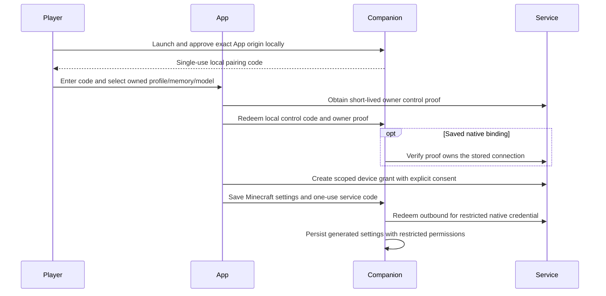

# Connect Minecraft through the App

The App configures an installed Minecraft companion through a consent-protected local connection. The browser does not install or silently launch native software. The companion initiates outbound requests to your selected IfSoul service; a hosted service never connects directly to your computer.

## Prepare the companion

Install Node22.18–24 and pnpm10.15.0, then run these four commands in a terminal:

```sh
git clone https://github.com/openifsoul/bridge-minecraft-mineflayer.git
cd bridge-minecraft-mineflayer
pnpm install --frozen-lockfile
pnpm companion
```

In an already prepared bridge folder, only the last command is needed for later launches. Open the companion address shown in the terminal, `http://127.0.0.1:8811`. Keep the terminal running while playing. No configuration file, UUID, provider key or token needs manual editing.

## Configure in Games

1. Open the App service you want to use: local, your self-hosted server, or the managed service. Each service owns its own memory. Opening another service does not copy records.
2. Open **Games**, choose **Configure Minecraft** on the Minecraft card, then open the companion consent page. Enter the exact App origin you opened yourself and approve it locally. Copy the displayed single-use code into the App. It expires after five minutes. The App also obtains a single-use owner proof from its authenticated service. The companion verifies that this owner may inspect a saved binding before showing its profile, memory or player details, including when accounts share the same App origin. The App's control session lasts fifteen minutes and is kept only in the current page, not browser storage. If your browser asks for local-network access, approve only the App and companion you intend to connect.
3. Enter the Minecraft host and port independently of the IfSoul App address. This connector uses Java Minecraft1.20.2 and the explicit trusted offline-server mode. Select only a server you own or are authorized to use and trust to report player identities. It does not change server authentication or sign in to a Microsoft account.
4. Choose the bot name and the player to receive private replies. The player must be online. The companion reads the selected player's UUID from the connected server roster; you do not enter a UUID.
5. Choose an owned character profile, memory, and an available provider/model. Approve **private dialogue**. Save the generated configuration and start. The status must become **Ready for private dialogue**.
6. In Minecraft, send `/tell LumenBot hello`, replacing the bot name if you chose another. Public chat and other players' whispers are ignored. The connector supplies no movement, combat, pathfinding or game-command authority.

Provider availability belongs to the selected service. Ollama can run on a service that configures it; own-key providers keep keys in that service's encrypted store; managed inference uses that service's balance and budgets. Game setup carries no provider key and adds no second AI charge. A synthetic scenario is available for a connection check without model inference.

The App saves settings through the authorized companion. Its native service credential is stored in the companion's restricted data directory, not exposed through status or the browser. The default directory is `~/.ifsoul/minecraft`; an operator can set `IFSOUL_COMPANION_DATA_DIR` before launch. Retain it for restart continuity.



## Continuity, stop and revoke

**Stop** disconnects the local game client and cancels pending sends. **Reconnect** creates a fresh game connection while retaining the approved memory. Uncertain sends are not replayed. A service restart preserves its durable participant events. Restarting the companion reads its saved configuration; re-approve the browser control session to manage it.

Reconfiguring the same service, Minecraft target/player, profile and memory to another provider renews the existing connection identity and preserves its private history. Changing the target, profile or memory creates a separate grant. Switching accounts at the same App origin requires a fresh owner proof. If it does not match the saved binding, its private details stay hidden and start/reconnect are blocked; clear it explicitly before approving the other account. Switching App services is explicit: clear the previous local binding before configuring the new service. It does not copy memory. Existing export/import remains an explicit filtered new-identity fork.

The native service credential expires one hour after approval and can be renewed through the App. Renewing invalidates the prior credential. **Revoke** immediately blocks the service grant, including late model completions. **Clear** stops the local client, asks the service to revoke the credential and removes local settings. If the service cannot confirm revocation, the App reports that fact; use the previous service's connection list to revoke it there. An offline service is never described as successfully revoked.

For connection failures, check the selected player is online, the supported version/trust mode, the two independent server addresses, model availability and managed spending limits. No automatic reconnect or paid-request retry loop runs.

## Embedding and security

`GameConnectionPort` is injected into `createAPI` by the authenticated composition. Owner routes list/create/revoke connections and read their authorized history. Native endpoints are separate exact paths under `/api/game/device/`: `redeem`, `owner-proof`, `ready`, `dialogue` and `revoke`. They accept bounded JSON without browser Origin/cookies. A single-use code or scoped bearer authenticates them; caller tenant, host and NPC IDs are never accepted as authority. The owner resolves profile/memory ownership and provider availability before issuing a grant.

The companion binds literal loopback, checks Host, requires local Origin plus CSRF consent, then permits only the approved exact App origin. Browser controls require a separate short-lived bearer and expose no arbitrary command/file API. Service URLs use HTTPS, except explicit loopback HTTP, and redirects are rejected. CSP permits only the fixed loopback companion address in addition to the service's existing origins. Private dialogue uses the existing participant runtime's audience filtering, one-NPC writer and revision/configuration fences.


## Operate a self-hosted service

The public Node service can use its existing owner-password/session-cookie authentication independently of IfSoul accounts. Choose a dedicated persistent data directory and a canonical public HTTPS origin; terminate TLS at your proxy and preserve that exact Host header. The HTTP listener defaults to loopback. Do not expose its backend HTTP port directly.

```sh
IFSOUL_DATA_DIR=/srv/ifsoul-data IFSOUL_PUBLIC_ORIGIN=https://ifsoul.example PORT=8788 pnpm start
```

The generated `owner.json` in that directory contains the owner password and encryption key. Keep it private and provide only the owner password to the person signing into that service. The App displays an owner sign-in form and a Sign out control; passwords are not stored in browser storage. Provider keys remain separately encrypted in the service. An operator can explicitly set `IFSOUL_LISTEN_HOST` for a protected proxy/container network; non-loopback listeners require a configured HTTPS public origin. A loopback HTTP public origin is supported for isolated local testing. Invalid origin/listener configuration fails before opening or creating a memory store. Changing the model does not change the data directory; changing service origins never copies it.

Signing out ends the browser owner session. Use Revoke or Clear to end the separately approved native companion grant. Local consent approval pauses an existing local client; reconnect after owner verification.

## Minecraft server-side bridges

| Bridge | Pinned Minecraft/runtime | Local acceptance |
| --- | --- | --- |
| Citizens 2.0.37 b3763 | Minecraft 1.21.4, Paper build 232, Java 21 | Native private dialogue |
| Easy NPC 6.0.2 | Minecraft 1.21.1, NeoForge 21.1.235, Java 21 | Native private dialogue |
| CustomNPCs Unofficial 1.21.1.20251230 | Minecraft 1.21.1, NeoForge 21.1.235, Java 21 | Builds and starts on the server; native dialogue pending |
| MineColonies 1.1.1403 | Minecraft 1.21.1, NeoForge 21.1.235, Java 21 | Builds and starts on the server; native dialogue pending |

Each server-side pairing grants private dialogue between one approved player
and one NPC. Game mechanics and group scope remain with the game. Game setup
does not prove model recall fidelity. The local Qwen model's source-faithful
Russian recall remains unverified.

In **Games → Configure Minecraft**, select the server software and Minecraft
version, then choose the matching bridge. Mineflayer retains its companion
flow. Citizens, Easy NPC, MineColonies and CustomNPCs-Unofficial require their
matching server-side IfSoul plugin or mod and an operator-selected NPC.

For these server-side bridges, select the owned character, memory and provider,
enter the server-authenticated player UUID and the specific NPC identity, then
approve private dialogue and issue a pairing code. MineColonies uses
`dimension/colony ID/citizen ID` for the NPC. The server operator enters the
one-use code in the bridge's configuration. An authenticated handshake must match
the owner-approved connector, runtime profile, player and NPC before dialogue
is accepted. The App displays the last handshake and grant status. A renewal
fences the old grant and requires a new handshake for the same target.

Install the server-side bridge separately on a compatible server. The App does
not infer which loader or mods a server is using from its address. The selected
runtime filters candidate bridge profiles. The authenticated device's runtime
declaration checks the selected profile; compatibility is verified separately
for each exact server/mod combination.

Desktop can install a reviewed local IfSoul bridge JAR through the connector's
**Install from local JAR** button. Select its exact build and your stopped
server's folder. Desktop verifies the pinned hash and places the JAR in the
expected `plugins` or `mods` directory. Existing files stay in place. Install
upstream mods and set the connector configuration with your server operator.
