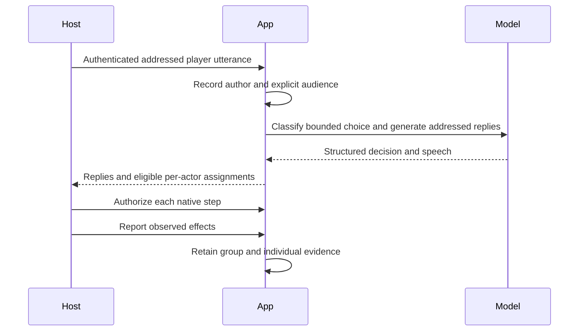

# Mineflayer group adventure

Configure a group in the local App's Games workspace with three distinct
character memories and a verified Minecraft player. Configure each bot's
forest collection bounds in the native host and grant the reported gather
capability for each connected character in App. The host asks for authorization
before each effect. Check the host's readiness when a character cannot join
the gather assignment.

Address the group for shared replies. An explicitly named private addressee
receives an individual reply and can use only evidence visible to both
participants. Opt in to public input to admit speech from the tracked
player in the current dimension. The vanilla Mineflayer host disables
public speaking because Minecraft broadcasts vanilla chat across dimensions.
Use the App's private reply route to answer that input for the paired
player. A request to have the characters speak to
each other opens an addressed exchange of at most two replies. A natural
request to collect wood may produce a structured assignment for each eligible
character. The host owns the forest, navigation and item collection.

Games → Adventure history shows the retained conversation, audience and
host-observed events. Laboratory → Adventure decision trace shows the context sent
to the group intent classifier, available choices, validated decision,
policy check, native handoff and measured steps. The trace contains
operational records and structured output. It does not expose hidden model
reasoning.

A group stop cancels pending generation and denies further checkpoints on
issued assignments. Old prompts and NPC output never create new group turns.
After a restart, the owner can still inspect retained events. A new
authorized native session is required to act again.

The Conversation channels table controls Listen, React and Speak per reported
channel. Listen admits eligible incoming speech to that character's memory.
React makes those events eligible for a response or an authorized assignment.
Speak allows delivery in that channel. Group and public grants are opt-in.
Private fallback requires a verified player and an available private route.
Native delivery checks the current policy again before sending a reply.
