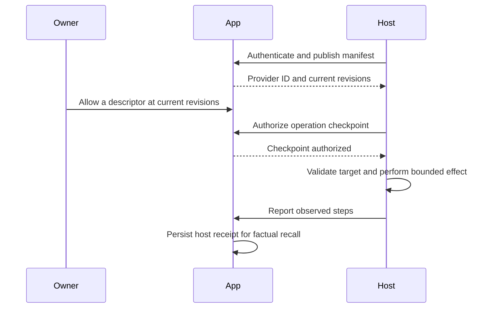

# Connected host capabilities

Open Games, select the connector and inspect a service connection. The Host
capabilities table shows the reporting world and embodiment, support, current
readiness and the owner's grant for each reported action. The selected
connection identifies the source when several providers advertise the same
intent. Refresh connection status after connecting or changing worlds.

Allow an action from the table to grant its current descriptor for the reported
world and embodiment. An unavailable action has a host reason. An offline
connection shows its last reported snapshot for the lifetime of the App process.
Owners write grants with expected provider, manifest and policy revisions.
Concurrent or stale writes require a refreshed view. Manifest removal or a
descriptor change invalidates the corresponding grant. After App restart or
a new native handshake, the host gets a fresh provider ID and in-flight
operations must stop. Existing durable observations remain available.

Hosts use authenticated bearer requests. POST `/api/game/device/ready` can
include a `capabilityManifest`. POST `/api/game/device/capabilities` sends
`{ providerId, capabilityManifest }`; repeat the identical snapshot to maintain
the 30-second lease, and increment the decimal revision for changes. Both
return the current capability information on the connection. POST
`/api/game/device/dialogue` with `operation: "action-check"` and an SDK
`CapabilityRequest` authorizes one checkpoint. The same endpoint accepts
`operation: "action-report"` and an SDK `CapabilityReport`. Device bearer
credentials stay with the native connector. The browser uses its owner session
to read connections and update policy.

App retains terminal status and observed steps as private host receipts.
Permission revocation stops future authorizations; effects already observed
may still be reported as late. Recall uses linked receipts and may describe
observations from a cancelled or partial action. A model's acknowledgement
confers no permission or evidence of execution.
