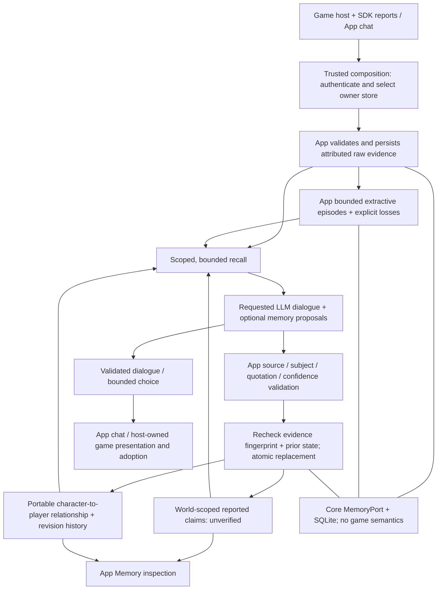
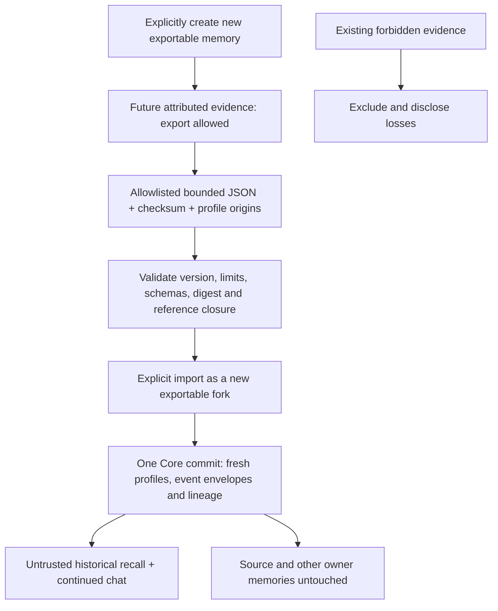

# Bounded memory architecture

App owns evidence ingestion, extractive episodes, recall and revisable
interpretations. Core supplies scoped transactional storage and runtime/provider
ports; SDK supplies bounded transport and observation callbacks. Hosts own
mechanics, identity mapping, outcomes and presentation. Managed hosting verifies
accounts and partitions stores before calling App; the self-hosted App uses its
protected local owner store.

## Evidence and authority flow

An observation-only request stops after persistence/retention and calls no model.
A requested dialogue may propose interpretations in that same call; a rejected
proposal preserves prior interpretations without implying dialogue failure.
The host must validate current legality before adopting any choice. Neither
speech, source assertions nor memory grants execution authority.

## Identity, reset and scope

The authenticated owner store is the outer isolation boundary. `memoryId` selects
memory inside that store, independently of the authored profile being portrayed.
A report captures its historical character perspective when recorded; a later
profile selection cannot rewrite it. The portable player identity is scoped to
that owner, not a universal multiplayer or cross-account identity service.
Roles remain world-specific; portable relationships preserve every cited world's
context. Changing provider does not replace the stored character history.

Reset removes this selected owner's retained bridge evidence and derived state
atomically. It leaves profiles, other memory environments, credentials and usage
records intact. Profile-only import/export still transfers authored material, not lived
memory. Separate App memory archives transfer only explicitly export-permitted
selected history into a new fork; existing forbidden records stay excluded. Local and managed databases are separate, unsynchronized stores.

## Relationship quality

Relationship interpretation and revision are model-dependent. Current validation
and persistence checks do not establish reliable semantic reassessment.

## Implementation map

- [Bridge API composition](../apps/server/src/bridge.ts): owner-injected service.
- [Evidence and retention](../apps/runtime-host/src/bridge-memory.ts).
- [Derived interpretations and validation](../apps/runtime-host/src/bridge-reflection.ts).
- [Memory tests](../tests/service/bridge-memory.test.ts) and
  [reflection integration tests](../tests/service/bridge-reflection-integration.test.ts).

The following details are the current App implementation, not additional Core
protocol promises or SDK responsibilities.

## Browser game continuity

The public server exports `runBridgeRequest`, `observeBridgeRequest`,
`inspectBridgeMemory` and `resetBridgeMemory`. A trusted composition supplies the
same owner-scoped `MemoryPort` used by the character workspace. Optional bridge
`memoryId` selects a memory owner independently of the portrayed profile; absent
it, the character ID owns memory. Workspace chat recalls that selected owner's
browser evidence across worlds and provider changes. Local SQLite and managed
Durable Object SQLite use this same public implementation.

Observation ingestion requires no model call. A hosting adapter must authenticate
and partition storage before calling these exports; browser identity fields never
select a user store. Browser reports remain attributed, unverified experience.
Server observations establish received host-labelled requests, not completed
play. Generated dialogue is stored as attributed speech, never game facts or
execution authority. No host permissions or mechanics change.

Continuity keeps at most 100 detailed interactions and 60 deterministic,
extractive request episodes, rather than stopping after a lifetime write count.
At the local write boundary, up to 20 oldest interactions become episodes in one
atomic storage transaction. Every ingested report and its actor/observer/recipient
roles survives extraction; context is shortened to 160 characters, and generated
speech is excluded. Historical agent IDs/names are captured at report time, even
if another profile later portrays the selected memory. Missing actors stay unknown.
An episode retains source ID, original recorded time and SHA-256 digest of the
original entry, plus explicit losses. Its summary is a retained source excerpt,
not an inferred fact. Derived views can be discarded/rebuilt from those excerpts;
the expired complete raw entry cannot be reconstructed or independently verified
from its digest. No LLM call, embeddings or vector service is used for consolidation.

Retention preserves the most substantive retained episode of each of up to 12
worlds (explicit reported outcomes before attributed actions, then excerpt
richness; oldest on ties), then the newest remaining episodes. Older episodes expire; inspection reports
pruned-source and dropped-episode counts. This is bounded memory, not a complete
archive or unlimited factual recall. Active serialized events stay below 900,000
bytes; recall selects at most 20 records and 12,000 serialized entry bytes, with
world representatives before relevance/recency. The final structured provider
request is packed below 21,000 bytes. The character catalog remains capped at 50.
Input/dialogue receipts expire with raw evidence: request conflict/idempotence is
guaranteed while a raw receipt or episode request digest remains; retained episode
source IDs prevent raw resurrection. Once an episode also expires, its old request ID may be accepted
again. Report deduplication covers retained raw and episode excerpts only.

Reset physically deletes this owner's retained bridge raw events, episodes,
checkpoints and matching bridge receipts in one transaction. It does not delete
other memory environments, profiles, provider credentials or paid-usage records;
no backup/third-party deletion propagation is claimed. Existing append-only reset
markers remain respected during local retention; their hidden prefix is pruned
rather than resurfaced. This requires an optional trusted-owner `MemoryPort.compact`
implementation; older adapters fail explicitly when retention is needed. Original
sources remain intact if consolidation fails. The local single writer performs
selection and synchronous compaction without an asynchronous gap. Local App accepts bounded conversation/decision requests at
`POST /api/bridge?provider=ollama&model=<configured-model>` (or an available
`openai` model). It uses the same local Host/Origin protection and owner store as
the App; configure provider credentials in App Settings, never in the SDK. This
route requires an explicit available real provider/model and returns the bridge
response directly. Its host context grants no execution authority. Generic SDK
clients configure this endpoint and send the `ifsoul-bridge/0.4.0` request; a host
must separately validate and execute proposed choices. Trusted hosting can inject
`APIOptions.bridge` after authenticating and partitioning its store; the export
alone does not enable hosted access or quotas. `POST /api/bridge/observations` accepts the same bounded request envelope and
returns an ingestion acknowledgment without selecting or calling a model. A
host queues observations through its own authenticated transport; SDK
`onObservation` remains an explicit caller-owned callback. The local server
wires both routes to the App owner store. Managed hosting wires them only after
principal authentication and user-store partitioning; generation uses its
existing BYOK/shared-budget provider path. The bridge accepts a bounded
locale tag and authored temperament; model language support is provider-dependent.
Stored App profiles are portrayed by character ID independently of the selected
memory owner, preserving authored goals, biography and speech style.

## Revisable interpretations

An already requested model dialogue may also propose at most four typed memory
updates in the same paid call. Observation ingestion remains free of inference.
The App validates these proposals separately after validating the dialogue.
Reported claims preserve an exact supporting quotation and remain unverified;
subjective relationship beliefs are directed from the historically portrayed
character to the owner-scoped player identity. Historical portrayals are never
silently reassigned to the currently selected profile. Legacy reports without a
captured perspective remain recallable but do not seed new interpretations.

Updates may revise a current role or opinion while retaining four previous
versions with source excerpts, digests, times and short reasons. Confidence is
bounded to 0.75; relationship confidence above 0.5 requires distinct cited
outcomes. A competitive game loss does not itself establish betrayal. Inference
receives at most 24 scoped reports and 6,000 source bytes. Inspection retains at
most 12 claims and 12 beliefs within a 96,000-byte reflection snapshot, alongside
the shared 900,000-byte bridge storage limit. These are bounded interpretations,
not a complete graph or archive. Derived citations may outlive the full raw
source; their retained excerpts cannot independently establish world truth.

The source fingerprint and prior state are rechecked before atomic replacement.
Concurrent stale results are discarded. Each historical perspective attempts
reflection once per retained evidence fingerprint, including failed, declined
and context-deferred attempts; no automatic additional paid call or retry occurs. A crash before
persistence can repeat a proposal on a later requested dialogue, but creates no
extra inference call and cannot double-append a completed revision. Source
retention changes may allow another attempt. Reset deletes derived snapshots in
the same owner partition as bridge evidence. Source-ID, quotation and subject
checks reject forged references; they do not prove natural-language entailment.
The Memory view exposes current interpretations, historical versions and sources.

Current role claims revise one subject's role within one world; independent
quoted preferences and reported events remain separate propositions. A directed
relationship has one portable summary per historical perspective and owner-scoped player across worlds and App chat. Current and historical sources retain their original world; role claims remain world-scoped. The record’s `hostId` labels its latest cited context, not its identity. Existing per-world relationships are read as one portable record, retaining up to four prior interpretations; legacy views remain explicitly contextual and uncertain until source-grounded reconciliation. The next normal reflection persists that view atomically. The
`trust`, `cooperation` and `caution` keys describe that summary's current facet,
not independent measured personality axes; a facet change revises the same
record and preserves the old facet/value. A revised opinion must cite newly
considered evidence. Retaining the exact same opinion with only old citations
does not manufacture another revision. Provider output remains fallible: a
character may keep a positive opinion or decline an update despite new reports.

Role and preference values require explicit `reportedClaims` on a source report:
`{ subject: "actor" | "recipient", key: "role" | "preference", value }`.
Claims are limited to four entries with 160-character values. The server resolves
those roles to the report's historical identities and validates exact
subject/key/value/source tuples. A role mentioned somewhere in a multi-subject
quotation cannot be reassigned to another participant. An unstructured report
may only yield a complete quoted `reported-event` attributed to its recorded
actor, rather than an inferred short role/preference. These optional source
assertions are still unverified browser reports, not trusted world state.

SDK report rows capture `perspectiveCharacterId` when the event is recorded.
Delayed queues preserve it even when another profile later sends the batch.
Rows without this historical perspective remain conversational evidence but do
not seed interpretations. Profile selection at upload time never supplies a
missing historical recipient identity. Per-owner retained sequence numbers keep
source selection ordered when several reports share a millisecond timestamp.

Confidence is a bounded model assessment, not a calibrated probability. Model
interpretations may be incorrect or omitted. If reflection would exceed the
request budget, the existing dialogue call proceeds without optional updates;
no second inference call is made. The Memory view distinguishes context-budget
deferral from rejected/unavailable reflection, no interpretations generated yet,
and a completed proposal with no grounded updates. Deferred fingerprints remain
bounded until new evidence; an empty relationship list never proves distrust.
A portable belief with identical value, confidence and reason does not acquire a
new revision solely because its citations changed. A new grounded explanation may
retain the same value and confidence; the model is never required to lower trust.
This check prevents citation-only history churn, not semantic errors in prose.
The structured-output grammar shares field constraints instead of repeating them
per report; exact claim tuples, subjects, outcome types, quotations and confidence
are still validated by trusted code before storage. Local packing deduplicates
trusted policy prose and empty derived context while retaining world/actor
attribution and the prior relationship needed for revision. Storage failures preserve the prior snapshot
and do not turn a valid dialogue into a claim that memory was updated.

## Bounded App memory archive

The Memory screen can create a **new empty exportable memory** with a profile
copy. This explicit action permits future records in that new owner-local memory
to be exported. It does not change old records, migrate old consent or make
existing `forbidden` / `consent-required` records exportable. A memory with no
eligible retained events produces an explanation, not an empty successful backup.
Profile-only import/export is unchanged.

The `ifsoul-app-memory/0.4.0` format is one UTF-8 JSON document, part of the common IfSoul 0.4.0 release, with a distinct shape from Core wire schemas. It is **not** an
implementation of the current Core archive-manifest / JSONL package contract.
There is no ZIP parser, extraction path, compression or filesystem entry import.
The envelope contains a canonical-JSON payload SHA-256, source memory identity,
creation time, filtered-fork intent, explicit losses/omission counts, historical
player identity, profile-origin mapping, referenced authored profiles, explicitly
unknown profile IDs, and retained event documents. Checksums detect modification;
they establish neither authorship nor trusted world state.

The current Core recall port yields a bounded selection: at most 500 events and
1,000,000 serialized recall bytes in the declared App/chat/laboratory/bridge
environments. Additional retained rows can fall outside that selection; this is
stated in every archive's losses. The complete JSON must fit 2,000,000 bytes and
50 profiles. Exceeding the archive/profile/record limit fails instead of silently
truncating its serialized payload. Counts describe this selected snapshot, not a
complete owner-store backup. Previously expired raw evidence cannot be recovered.
Raw reports, retained extractive episodes and source-closed reflections with
revision history can be included. Reflection citations must match exact report
digests, excerpts, historical perspectives and subject identities in eligible
retained evidence. Reflections with expired/restricted citation sources are
excluded and counted, rather than exporting a restricted excerpt indirectly.
Episodes preserve their original retained excerpt and original-source digest;
that digest does not reconstruct expired source bytes.

Import revalidates the exact preview digest and all documents before a single
`MemoryPort.commit` atomically inserts profiles, events and local fork lineage.
Every destination character, participant and event envelope ID is newly allocated;
no existing profile or memory is overwritten or merged. Original historical
report payloads, source IDs/digests and actor identity are preserved. A fork-local
alias maps copied runtime profiles to those historical perspectives and preserves
the source owner-local player identity for relationship continuity. These aliases
never query or authorize access to an unrelated destination profile/store with the
same historical ID. Unknown historical actors remain unknown; missing authored
profiles are not invented. New evidence in the fork uses that explicit historical
mapping. Episode envelope IDs are namespaced by destination owner so two imports
can independently consolidate without colliding, while original source digests
remain unchanged.

Imported records are untrusted historical evidence, including a source's claims
about itself. Trusted fork lineage marks imported event IDs for inference only:
imported task reports enter a separate `importedReports` group, never the
host-confirmed `hostReports` group, even when their original status is succeeded.
New locally reported outcomes in that fork keep their normal classification.
Failure to read lineage stops inference instead of assuming native history.
Reflection maps, items, versions and sources, plus nested laboratory results, are
validated before import; malformed state cannot create a partially imported fork. No scope field, checksum, profile ID or lineage grants account rights,
consent, a live host binding or execution authority. Import creates a portable new
fork with export allowance for its eligible history and future records, as stated
in the confirmation. It never claims same-identity resume or writer handoff.
Provider credentials/settings, authentication, paid-usage records, receipts,
private configuration and active execution handles are not transferred. The
allowlist is not a content scanner: do not type secrets into exportable dialogue.
Required/unknown extensions are rejected on import; unsupported exported records
are explicitly counted as omissions. No migration, distributed merge, deletion
propagation or complete backup claim is made.

HTTP integration uses authenticated owner-selected workspace methods at
`GET /api/memory/export`, `POST /api/memory/preview`,
`POST /api/memory/import`, and `POST /api/memory/new`; existing Host/Origin,
authentication and API busy protections remain in force. The local HTTP adapter
accepts preview/import request envelopes up to 2,010,000 bytes, including the
2,000,000-byte archive and wrapper; unrelated request limits remain unchanged. Managed hosting must
still authenticate and partition its owner store before using the public App API.
